# SquirrelStock: инструкция для работника склада

Короткие ответы на вопрос «как сделать». Настройка программы и подробности — в [GUIDE.ru.md](GUIDE.ru.md). Все имена и номера в примерах вымышленные.

**Где меню.** Кнопка ☰ в левом верхнем углу открывает меню. Меню само раскрывается до пункта открытой страницы, сам пункт подсвечен. Если меню нужно всё время, нажмите булавку вверху меню: оно перестанет прятаться при переходе на другую страницу (на телефоне меню всё равно прячется, чтобы не закрывать экран). Это то же, что снять галочку «Скрывать боковое меню» в профиле. Ниже путь записан так: «Сервисные страницы → Выдача расходников». Ваш профиль и выход — под именем пользователя справа вверху.

**Провести.** Документ меняет остатки, только когда он проведён: кнопка «Провести» внизу документа. «Сохранить» оставляет черновик. Формы «Выдача расходников» и «Выдача оборудования по договору» проводят документ сами.

## 1. Выдать расходники

Меню: **Сервисные страницы → Выдача расходников**. Форма короткая, работает и с телефона.

1. «Получатель»: начните вводить имя и выберите из подсказки. Если такого получателя ещё нет, допишите имя полностью: он будет добавлен в справочник. Признак («подопечный», «по запросу», «снят с опеки»), адрес и телефон потом укажите в **Справочники → Контрагенты**: щёлкните имя, выберите «Признак получателя», нажмите «Сохранить». Признак виден рядом с именем в списке, по нему можно отобрать список («Признаки и теги» над списком). Как найти дом, код домофона и другие замечания пишите в «Примечание» там же; отделение или выездную службу можно указать тегом.
2. Проверьте «Дату» и «Склад».
3. «Что выдаем»: начните вводить название позиции. В подсказке только то, что есть на складе, с остатком. Укажите количество и нажмите «Добавить». Так добавьте все позиции.
4. При необходимости заполните «Примечание».
5. Нажмите «Выдать».

Что увидите: «Выдано: накладная РН-…, получатель …, позиций: N». Документ («Выдача (накладная)» с ценой 0) появляется в «Общем журнале» и в отчётах. Если позицию этому получателю выдавали недавно, под строкой появится красное предупреждение (раздел 8).

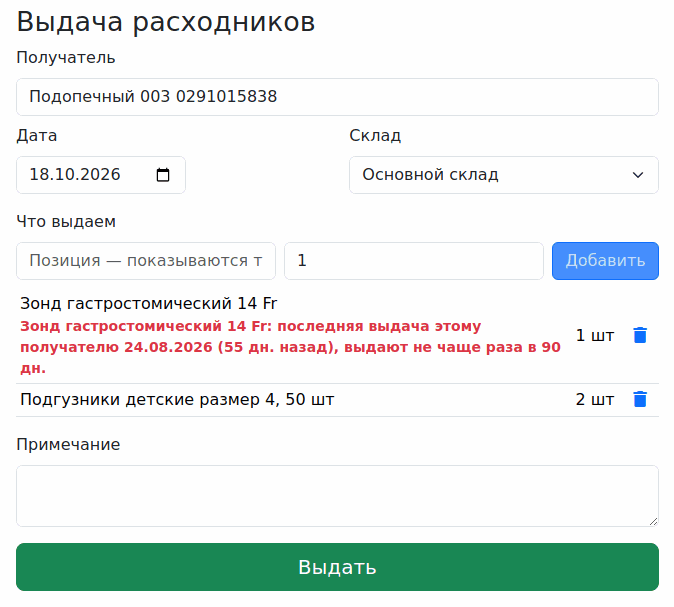

## 2. Выдать оборудование по договору

Меню: **Сервисные страницы → Выдача оборудования по договору**. Получатель, договор и оборудование заполняются в одной форме.

1. «Получатель»: «ФИО или название» — начните вводить и выберите из подсказки; телефон и адрес подставятся. Для нового получателя заполните имя, телефон и адрес.
2. «Договор»: номер предлагается следующий по порядку, его можно изменить. Проверьте дату. «Срок пользования до» — дата окончания; если срока нет, оставьте отметку «До востребования». «Кем направлен» — кто направил получателя; для получателя из справочника поле заполняется из его последнего договора, при необходимости исправьте. «Договор заключен с» — если договор подписывает не сам получатель, а его представитель (обычно родитель), впишите ФИО представителя; получателем выдачи остается подопечный. Если договор с самим получателем, поле оставьте пустым. Для получателя из справочника поле заполняется из его последнего договора, где оно было указано; при необходимости исправьте. Представитель печатается в накладной выдачи и в возврате по этому договору и показывается рядом с договором в отчете «Оборудование: где сейчас» и в карточке получателя; исправить его можно в «Справочники → Договоры», открыв договор.
3. «Оборудование»: начните вводить модель, инвентарный или заводской номер и выберите единицу из подсказки, нажмите «Добавить». В подсказке только единицы, которые есть на складе.
4. Нажмите «Оформить выдачу».

Что увидите: создан договор в состоянии «В работе» и проведённая расходная накладная по нему. Единица в отчёте «Оборудование: где сейчас» числится у получателя, с договором и сроком.

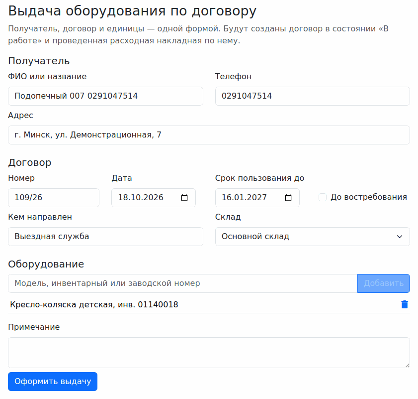

## 3. Принять возврат

Возврат оформляется на основании выдачи: позиции и получатель подставляются сами. Так же возвращают и расходники, и оборудование.

1. Меню: **Журналы → Общий журнал**.
2. Найдите выдачу («Выдача (накладная)» на этого получателя) и нажмите на строку.
3. В строке документа нажмите «Создать» → «Возврат от получателя».
4. Откроется «Возврат от получателя» со всеми позициями выдачи. Если возвращают не всё: кнопкой ✎ исправьте количество, кнопкой 🗑 удалите строку.
5. Проверьте дату и нажмите «Провести».

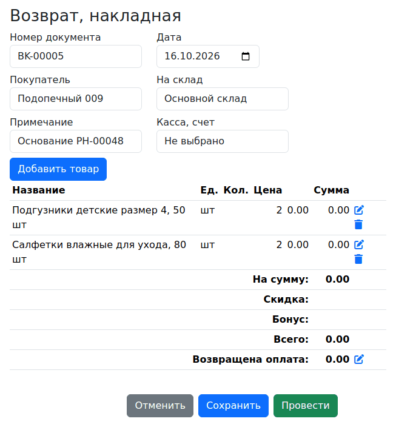

Что увидите: остаток на складе вырос. В «Акте списания за месяц» возврат идёт со знаком минус, в «Обороте по позициям» — в колонке «Возвращено». Вернувшееся оборудование в отчёте «Оборудование: где сейчас» снова числится на складе.

## 4. Списать (порча, истёк срок, брак)

Меню: **Документы → Склад → Списание ТМЦ**.

1. Проверьте «Дату» и склад («Со склада»).
2. В «Примечании» напишите причину: например, «истёк срок годности» или «повреждена упаковка». Причина сохранится в документе.
3. Нажмите «Добавить позицию», выберите позицию и количество (для оборудования — единицу по инвентарному номеру).
4. Нажмите «Провести».

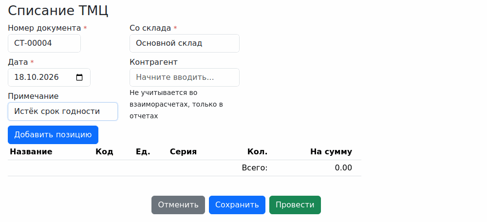

Что увидите: остаток уменьшился; в «Обороте по позициям» — колонка «Списано».

Список списаний с причинами для бухгалтерии — **Отчеты → Склад → Списания с причинами**: «С», «По», при необходимости категория или слово из причины («Причина содержит»), «OK». В таблице дата, документ, склад, позиция, инвентарный номер, количество и причина; значок Excel — над таблицей.

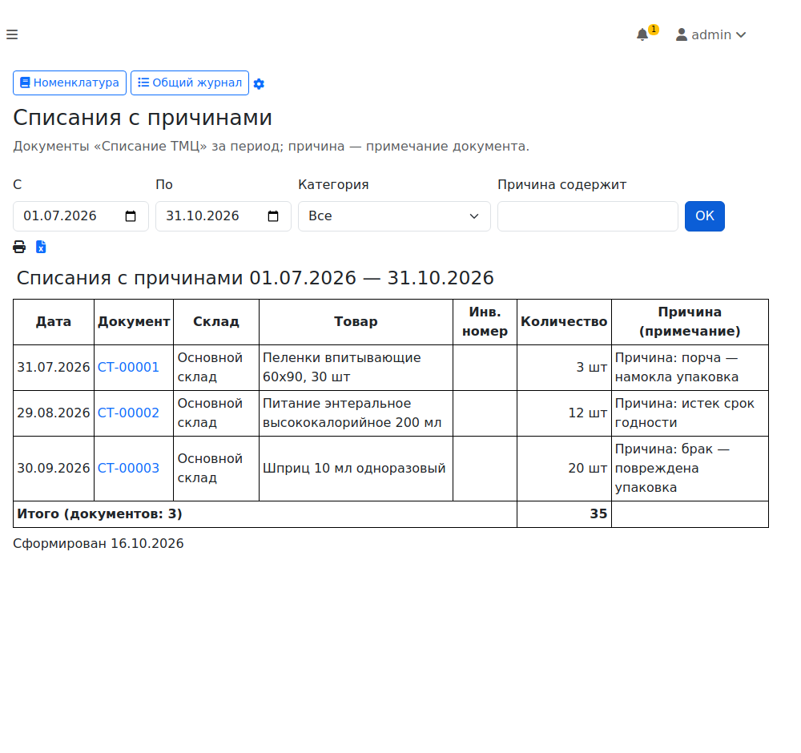

Неисправное оборудование, которое ещё не решили списывать, переместите на склад «Ремонт» или «К списанию»: **Документы → Склад → Перемещение ТМЦ**. В отчёте «Оборудование: где сейчас» оно будет видно на этом складе.

## 5. Оприходовать поступление

**От донора или поставщика** — меню **Документы → Поступление → Приходная накладная**.

1. «Поставщик»: начните вводить и выберите из подсказки; нового добавьте кнопкой «+».
2. Проверьте «Дату» и склад («На склад»).
3. «Добавить позицию»: позиция, количество, цена (для пожертвования можно 0). Так добавьте все позиции.
4. Нажмите «Провести».

Без поставщика (например, излишек после пересчёта) — **Документы → Склад → Оприходование ТМЦ**, шаги те же.

**Из ведомости 1С** — меню **Сервисные страницы → Импорт ведомости 1С**. Так загружают справочник и остатки при начале работы или после выгрузки из бухгалтерии.

1. В 1С сохраните оборотно-сальдовую ведомость в Excel (.xls или .xlsx): по счёту 10 (материалы) или по счёту 01 (основные средства).
2. «Файл импорта» — выберите этот файл.
3. Проверьте «Склад» и «Дату оприходования» (пусто — дата ведомости, конец её периода); для новых позиций можно выбрать «Категорию для новых позиций».
4. Нажмите «Импортировать».

Что увидите: по счёту 10 — позиции и остатки по цене «сумма / количество» (сумма остатков совпадает с ведомостью до копейки — настройка «Цена партии», [GUIDE.ru.md](GUIDE.ru.md)), по счёту 01 — единицы оборудования с инвентарными номерами. Названия остаются как в 1С. Повторный импорт материалов приходует их ещё раз, а единицы с инвентарными номерами не дублирует. Строки, которые программа не смогла однозначно сопоставить, показываются списком и не приходуются: оприходуйте их вручную. Строки с суммой без количества (обычно остаток округления в 1С) не переносятся и тоже показываются отдельной таблицей с итогом.

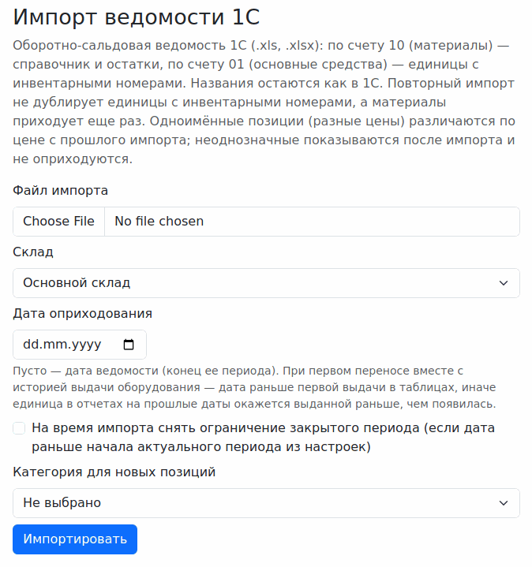

## 6. Ответить на типовые вопросы

### 6.1. Сколько выдано за период

Меню: **Отчеты → Склад → Оборот по позициям**.

1. Укажите «С» и «По».
2. При необходимости выберите «Категорию».
3. Нажмите «OK».

Что увидите: по каждой позиции — на начало, приход, «Выдано», «Возвращено», «Списано», «Прочее» (перемещения между складами, инвентаризация), на конец и число выдач.

### 6.2. Сколько выдано одному подопечному

Меню: **Отчеты → Склад → Карточка получателя**. Начните вводить ФИО или телефон в поле «Получатель», выберите из подсказки, при необходимости поменяйте «С» и «По» и нажмите «OK». Короче — щёлкнуть имя получателя в журнале выдач («Журналы → Выдачи») или значок карточки рядом с карандашом в «Справочники → Контрагенты»: карточка откроется сразу, за последние 12 месяцев.

Что увидите:

- телефон, адрес, теги и «Кем направлен» (из договоров);
- «Оборудование на руках» — что выдано по договору и не возвращено: инвентарный номер, договор, срок; кнопка «Продлить» продлевает срок и возвращает в карточку;
- «Выданные расходники» — по каждой позиции: выдано, возвращено, итого получил, число выдач; ниже то же по месяцам (возврат вычитается из месяца выдачи);
- «Выдачи и возвраты» — список документов, номер открывает документ;
- «Когда можно следующую выдачу» — для позиций с интервалом выдачи (например, гастростомическая трубка раз в 90 дней): последняя выдача и дата, с которой можно снова.

Значки вверху: печать и выгрузка в Excel.

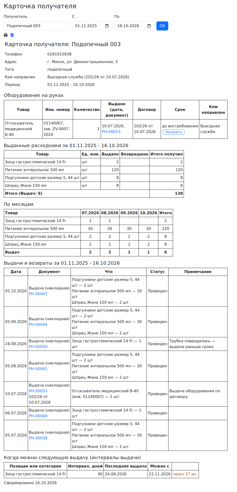

Другой путь — отчёт **Оборот по позициям**: в поле «Получатель» выберите имя и нажмите «OK». Останутся только выдачи и возвраты этого получателя.

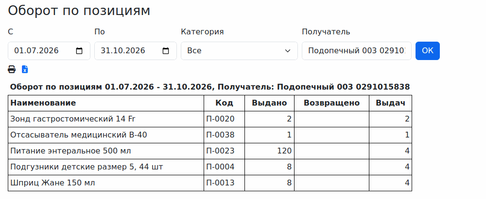

Кто в каком месяце получал — **Отчеты → Склад → Получатели по месяцам**.

### 6.3. Что на руках у получателей

Меню: **Отчеты → Склад → Оборудование: где сейчас**, кнопка «OK».

Что увидите:

- вверху «Итого по моделям»: сколько выдано, сколько на каждом складе («Ремонт», «К списанию»), всего;
- список единиц: где сейчас, у кого, с телефоном, адресом, договором и сроком; просроченный срок выделен красным;
- внизу «Мелкое оборудование на руках» — то, что без инвентарных номеров (ходунки, ванночки): у кого, сколько, по какому договору.

В поле «Поиск» можно ввести модель, инвентарный или заводской номер.

Печать (значок принтера над таблицей) — на альбомном листе, шапка таблицы повторяется на каждом листе, внизу номер страницы.

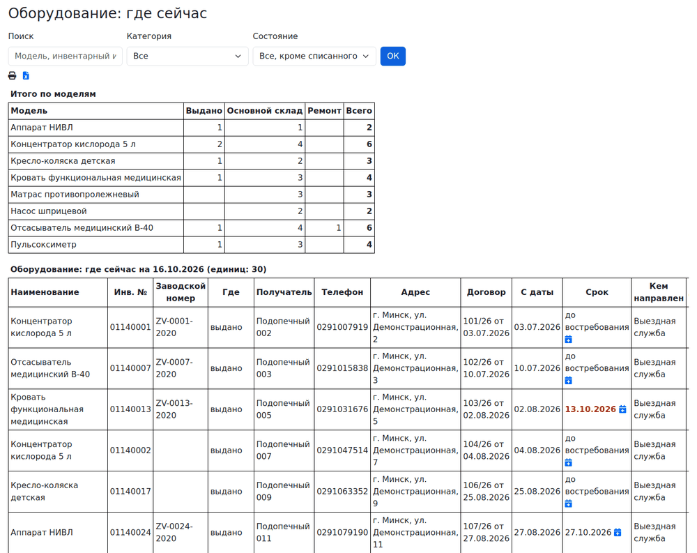

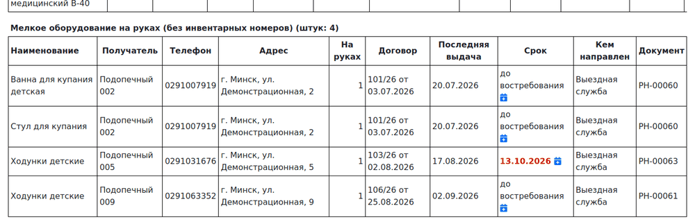

### 6.4. Какой остаток

Меню: **Отчеты → Склад → Состояние складов**, кнопка «OK». По каждой позиции — количество на каждом складе. Значки над таблицей: печать, Excel и PDF.

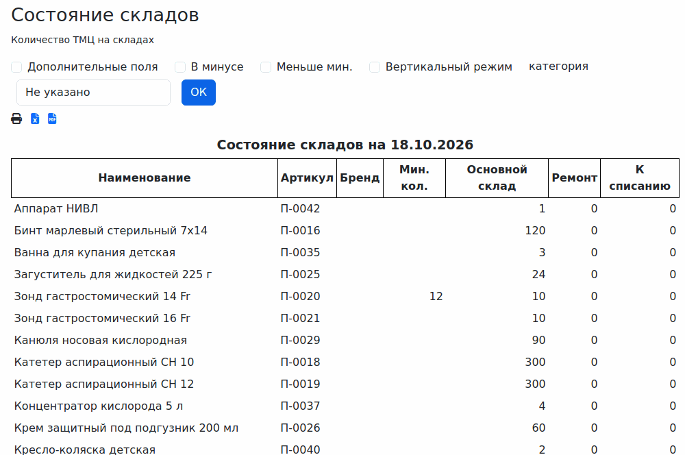

Что пора докупать — **Отчеты → Склад → Ниже минимального остатка**: позиции, у которых остаток меньше минимального, и сколько не хватает. Минимум задаётся в карточке позиции («Справочники → Товары → Номенклатура»).

## 7. Акт списания в Excel

Меню: **Отчеты → Склад → Акт списания за месяц**.

1. Выберите «Год» и «Месяц».
2. «Что списано»: «Расходники» (так открывается) — акт на расходные материалы; «Оборудование (по договорам)» — отдельный акт на оборудование: единицы с инвентарным номером и мелочь, выданная по договору; «Всё вместе» — один акт на всё. «Категория» сужает акт ещё больше.
3. «Заголовок» печатается над таблицей; по умолчанию «Списание расходников» или «Списание оборудования» — меняется вместе с «Что списано», если вы не вписали свой.
4. Нажмите «OK».
5. Над таблицей нажмите значок Excel (второй, после принтера) — файл скачается.

Что увидите: строки — позиции, колонки — выдачи «Получатель, дата», итоги. Возвраты идут со знаком минус. Названия позиций — как в 1С, даже если позицию переименовали в программе.

Печать (значок принтера) — на альбомном листе. Если выдач за месяц больше 10, акт печатается частями по 10 колонок: в каждой части колонка «Наименование», «Итого» по позиции — в последней части. В Excel акт остаётся одной таблицей.

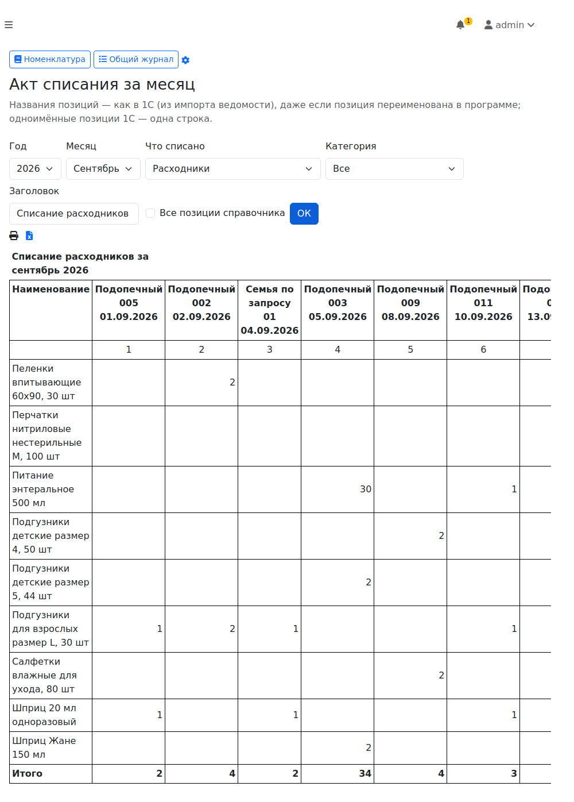

## 8. Напоминания

**Срок пользования оборудованием** — на главной странице (меню «Главная»). В блоке выданное оборудование, у которого срок истёк или истекает в ближайшие две недели: получатель, телефон, договор, «Срок до». Мелкое оборудование, выданное количеством по договору со сроком, — тоже, с количеством на руках («штук: 2»). Просроченное — красным: «просрочено на N дн.». Позвоните получателю: оформите возврат (раздел 3) или продлите срок.

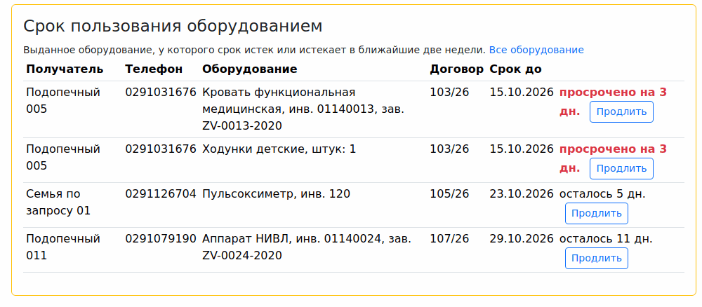

Продлить срок: кнопка «Продлить» в строке напоминания (или значок календаря с плюсом в колонке «Срок» отчёта «Оборудование: где сейчас»).

1. Откроется «Продлить срок пользования»: договор, получатель, оборудование по договору и срок сейчас.
2. Укажите новую дату в «Срок пользования до» или поставьте отметку «До востребования».
3. Нажмите «Продлить».

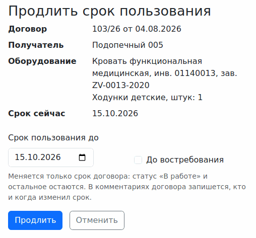

Что увидите: «Договор 103/26: срок 31.12.2026», напоминание исчезло (или показывает новую дату). Статус договора остаётся «В работе», а в комментариях договора (**Справочники → Договоры**, номер договора) записано, кто, когда и с какой даты на какую изменил срок.

**Слишком частая выдача.** Для некоторых позиций задан интервал, например «гастростомические трубки — не чаще раза в 90 дней» (**Справочники → Товары → Интервалы выдачи**). Если получатель уже получал такую позицию раньше срока, при выдаче появится красное предупреждение с датой последней выдачи. Это подсказка, а не запрет: выдать всё равно можно (например, если трубка повредилась).

## 9. Резервная копия

Меню: **Сервисные страницы → Резервная копия**.

**Что программа делает сама.** Если администратор настроил расписание, раз в сутки копия всей базы сохраняется в папку на этом компьютере и, если настроено, в сетевую папку и в одно или несколько облаков (в облака — зашифрованной). По умолчанию в каждом месте хранятся последние 30 копий.

**Что проверять.**

1. На главной странице нет красного сообщения «Нет удачной резервной копии больше 48 ч» (его видит администратор).
2. На странице «Резервная копия» в таблице «Автоматическая копия» у каждого места свежая дата в «Последняя удачная копия» и пусто в «Ошибка последней попытки».
3. В конце рабочего дня сделайте копию вручную: «Создать копию» — скачается zip-файл. Храните его не на этом компьютере, например на флешке. Если программа работает на этом же компьютере, копию можно записать на флешку сразу: вставьте флешку, в блоке «Копия на флешку» в поле «Папка или диск» укажите её букву (например, `E:\`) и нажмите «Скопировать туда» — появится «Копия сохранена: …».

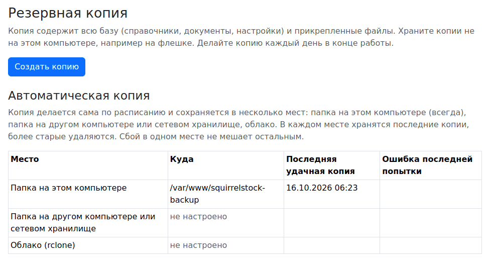

**Как восстановить.** Восстановление заменяет все текущие данные данными из копии — делайте его только по согласованию с администратором.

1. В разделе «Восстановление из копии» выберите файл копии (.zip).
2. Для копии из облака введите пароль шифрования.
3. Поставьте отметку «Понимаю: текущие данные будут заменены данными из копии».
4. Нажмите «Восстановить».

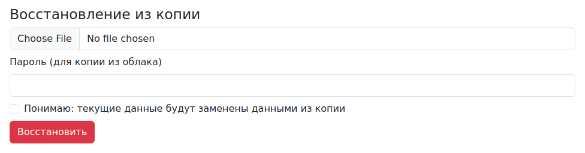

Что увидите: «Данные восстановлены из копии». Войдите в программу заново.

## 10. Вход в программу

### 10.1. Смена пароля

1. Под именем пользователя справа вверху выберите «Мой профиль».
2. В блоке «Смена пароля» введите «Новый пароль» и «Подтверждение».
3. Нажмите «Сохранить».

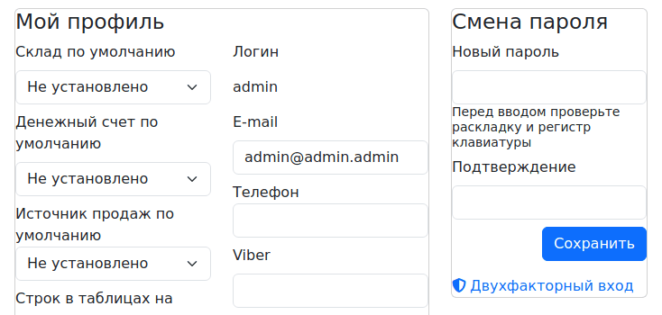

Пароль `admin` после установки смените сразу: пока он не сменён, программа напоминает об этом.

### 10.2. Двухфакторный вход

После пароля программа спрашивает шестизначный код из приложения на телефоне. Даже если пароль узнают, без телефона войти не получится.

1. Установите на телефон приложение-аутентификатор (Google Authenticator, Aegis, FreeOTP и т. п.).
2. «Мой профиль» → ссылка «Двухфакторный вход» под сменой пароля.
3. Отсканируйте QR-код приложением (или введите ключ вручную).
4. Введите код, который показывает приложение, и нажмите «Включить».
5. Программа покажет резервные коды — один раз. Запишите их и храните отдельно от телефона: каждый код заменяет код из приложения при одном входе.

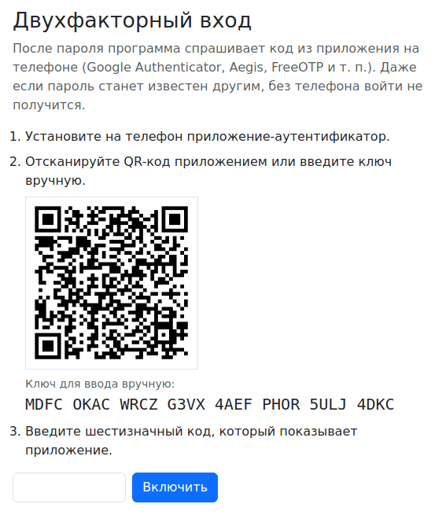

Что увидите при следующем входе: после логина и пароля — поле для кода. Если телефон потерян и резервных кодов нет, администратор сбрасывает двухфакторный вход на той же странице («Сбросить двухфакторный вход пользователю»); после этого вход снова по паролю, и включить его можно заново.

### 10.3. Светлая или тёмная тема

Кнопка с наполовину закрашенным кругом справа вверху, рядом с колокольчиком уведомлений, открывает выбор: «Светлая», «Тёмная» или «Как в системе». Тема меняется сразу и запоминается: на другом компьютере после входа будет та же. «Как в системе» повторяет настройку Windows, телефона или браузера и меняется вместе с ней, например вечером, если система переключается на тёмную сама. Тот же выбор есть в «Моём профиле», поле «Тема».

Печатные формы, PDF и Excel всегда светлые, тема на них не влияет.
